# 高校宿舍管理系统时序图与状态图汇总

> 本文件由同目录 .mmd 源文件生成。设计依据、状态字典和待确认规则见《00 时序图与状态图设计说明》。

[设计说明与一致性对照](./00%20时序图与状态图设计说明.md)

> 时序图仅使用学生、宿管、系统管理员、维修人员和系统生命线，每张图只列出参与该流程的角色。原有 7 张状态图保持不变。

## 1. 业务时序图

### 1.1 01 登录时序图

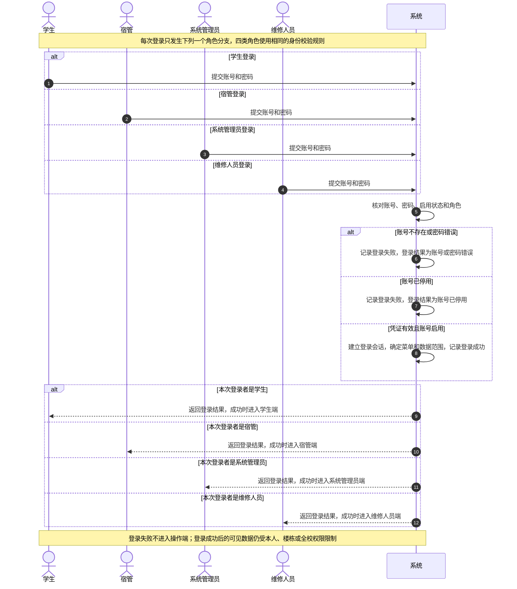

### 1.2 02 报修提交审核时序图

```mermaid
sequenceDiagram
    autonumber
    actor Student as 学生
    actor Manager as 宿管
    participant System as 系统

    Student->>System: 填写故障位置、分类、维修工种、描述和备注
    opt 补充故障图片
        Student->>System: 上传故障图片
        System-->>Student: 返回图片上传结果
    end
    Student->>System: 选择保存草稿或提交报修
    System->>System: 核对本人、有效住宿、内容图片、可编辑状态和操作期限
    alt 校验不通过或工单已发生变化
        System-->>Student: 提示原因，不接受本次非法操作
    else 保存草稿
        System->>System: 保存未提交编辑，首次草稿为待编辑
        System-->>Student: 草稿已保存，尚未提交审核
        Note over Student,System: 退回工单保存编辑仍为待修改，原重交期限不变
    else 正式提交或待修改期限内重交
        System->>System: 保存新的提交版本，工单变为待审核
        System-->>Student: 提交成功，待审核
        System-->>Manager: 通知管辖楼栋宿管审核已提交工单
    end

    opt 工单仍为待审核，宿管进行审核
        Manager->>System: 查看管辖楼栋的报修详情
        System-->>Manager: 展示已提交内容、故障图片和历史审核记录
        Manager->>System: 提交通过结论，或填写原因退回，可标记紧急
        System->>System: 核对楼栋权限、待审核状态和当前提交内容
        alt 越权、内容已变化、已撤回或退回原因缺失
            System-->>Manager: 审核未生效，提示原因并要求刷新
        else 审核通过
            System->>System: 保存审核结论，工单变为待派单
            alt 普通且非重修工单
                System->>System: 纳入自动派单池
            else 紧急或重修工单
                System->>System: 纳入手动派单池，不进入普通自动池
            end
            System-->>Manager: 审核通过，待派单
            System-->>Student: 通知审核通过及后续维修安排
        else 审核不通过
            System->>System: 保存不通过原因，工单变为待修改，设置重交期限
            System-->>Manager: 审核结果已保存
            System-->>Student: 通知修改原因及重新提交期限
        end
    end

    opt 学生在待修改期限内重新提交
        Student->>System: 按原因修改原工单并重新提交
        System->>System: 再次核对本人、内容、待修改状态和期限
        alt 仍允许重新提交且内容合法
            System->>System: 保留旧版本和审核历史，保存新版本，变为待审核
            System-->>Student: 重交成功，待审核
            System-->>Manager: 通知审核新提交版本，审核步骤同上
        else 已逾期、状态变化或内容不合法
            System-->>Student: 拒绝重交并说明原因
        end
    end

    opt 学生申请撤回
        Student->>System: 撤回本人报修工单
        System->>System: 核对可撤回状态且该工单从未正式派单
        alt 已经正式派单或当前状态不允许
            System-->>Student: 不允许撤回，保留当前工单
        else 正式派单前仍可撤回
            System->>System: 工单变为已撤销，保留原单及版本和审核历史
            System-->>Student: 撤回成功
            System-->>Manager: 通知该工单已撤回
            opt 学生选择复用原工单
                Student->>System: 继续编辑已撤销工单
                System->>System: 核对仍可复用，工单回到待编辑，保留撤回历史
                System-->>Student: 返回原工单供继续编辑和提交
            end
        end
    end

    opt 待修改工单到达重交截止时间
        System->>System: 再检查仍为待修改且未按期重交
        alt 确实逾期且状态未变化
            System->>System: 工单变为已关闭，再归档，记录逾期原因
            System-->>Student: 通知工单因逾期未重交已关闭并归档
        else 已重交、已撤回或尚未到期
            System->>System: 不执行逾期关闭
        end
    end
    Note over Student,System: 已驳回仅是审核结论，当前状态为待修改；逾期关闭不产生维修完成、确认或评价
    Note over Manager,System: 后续派单和维修见 03 图，学生确认、评价及重修见 17 图
```

### 1.3 03 报修派单维修时序图

```mermaid
sequenceDiagram
    autonumber
    actor Student as 学生
    actor Manager as 宿管
    actor Admin as 系统管理员
    actor Worker as 维修人员
    participant System as 系统

    Note over Manager,System: 普通工单自动派单；紧急、重修和异常工单只进手动池
    opt 普通工单已审核通过并处于自动派单池
        loop 每次工单进入待派单且仍具备自动派单资格时
            System->>System: 核对待派单状态，按资质、范围、在岗和负荷选择未尝试人员
            alt 有合格的新候选人员
                System->>System: 建立一次自动派单，工单变为待接单，开始接单计时
                System-->>Worker: 发送自动派单通知和接单截止时间
                alt 维修人员在接单期限内响应
                    Worker->>System: 查看工单并选择接单或填写原因拒单
                    System->>System: 核对本人、当前派单有效性和响应期限
                    alt 无权操作、派单失效或已超时
                        System-->>Worker: 不接受响应，提示当前派单已不可处理
                    else 接单
                        System->>System: 派单记录变为已接单，工单变为已接单，开始维修计时
                        System-->>Worker: 接单成功，告知维修截止时间
                        System-->>Student: 通知已接单及维修安排
                    else 拒单且原因合法
                        System->>System: 派单记录变为已拒单，保存原因，记录一次拒单
                        System-->>Worker: 拒单结果已保存
                    else 拒单原因缺失
                        System-->>Worker: 拒单未生效，须填写原因，原接单期限仍有效
                    end
                else 接单期限到达
                    System->>System: 再检查当前派单仍待接单且确实未响应
                    alt 仍未响应
                        System->>System: 派单记录变为超时未接，记录一次接单超时
                    else 已接单、已拒单或已作废
                        System->>System: 不重复记录接单超时
                    end
                end
                opt 本次派单最终已拒单或超时未接
                    System->>System: 汇总拒单次数与接单超时次数
                    alt 合计不超过 2 且还有合格的新候选人员
                        System->>System: 工单回到待派单，重新进入自动派单池
                    else 合计超过 2 或候选人员耗尽
                        System->>System: 工单变为待人工处理；合计超过 2 时标记异常
                        System-->>Manager: 通知人工协调或强制派单
                    end
                end
            else 无匹配人员、负荷已满或没有新候选人员
                System->>System: 工单变为待人工处理，记录无法派单原因
                System-->>Manager: 通知协调合格人员
                Note over Manager,System: 无候选人员本身不等于达到异常次数门槛
            end
        end
    end

    opt 紧急、重修、异常或待人工处理工单需要手动派单
        alt 管辖宿管处理
            Manager->>System: 查看工单和合格人员，指定维修人员强制派单
        else 系统管理员具有对应全局处理授权
            Admin->>System: 查看工单和合格人员，指定维修人员强制派单
        end
        System->>System: 核对操作者权限、工单状态、维修资质和负责范围
        alt 校验通过
            System->>System: 作废尚未完成的旧派单，保留历史，建立新的强制派单
            System->>System: 自动确认接单，工单变为已接单，开始维修计时
            System-->>Worker: 通知强制派单及维修期限，无需再次确认接单
            System-->>Student: 通知维修安排
        else 不允许派单或没有合格人员
            System->>System: 保持当前状态，记录无法派单原因
        end
        alt 本次操作者为宿管
            System-->>Manager: 返回手动派单结果及原因
        else 本次操作者为系统管理员
            System-->>Admin: 返回手动派单结果及原因
        end
    end

    opt 工单仍为待人工处理，管理人员进一步协调
        alt 宿管发起协调
            Manager->>System: 提交人员协调结果，或确认不属于校内维修范围
        else 系统管理员获授权处理
            Admin->>System: 提交全局协调结果，或提交获授权的退回处理
        end
        System->>System: 核对处理权限、当前工单、协调依据或退回原因与期限
        alt 校验不通过
            System->>System: 不应用处理结果，保留当前状态并记录原因
        else 确认不属于校内维修范围
            System->>System: 记录退回原因与重交期限，工单变为待修改
            System-->>Student: 通知按原因修改工单，重交和逾期处理按 02 图
        else 非异常普通工单已协调到合格的新候选人员
            System->>System: 工单回到待派单，重新进入自动派单池
        else 紧急、重修、异常工单，或仍无法派单
            System->>System: 保持待人工处理，紧急、重修和异常工单仍只允许手动派单
        end
        alt 本次处理者是宿管
            System-->>Manager: 返回协调结果或未生效原因
        else 本次处理者是系统管理员
            System-->>Admin: 返回协调结果或未生效原因
        end
    end

    opt 当前负责人需要延期
        Note over Worker,System: 申请与审核见 12 维修延期审核时序图
    end

    opt 工单为已接单或维修延期，当前负责人完成维修
        Worker->>System: 提交维修结果和完工照片
        System->>System: 核对当前负责人、工单状态、维修结果和照片
        alt 负责人已变更、状态失效或内容不合格
            System-->>Worker: 不接受完工提交并说明原因
        else 完工提交有效
            System->>System: 保存维修结果，结束未决延期，工单变为已维修，开始确认计时
            System-->>Worker: 完工提交成功，等待学生确认
            System-->>Student: 通知查看维修结果和完工照片并确认
        end
    end

    opt 维修截止时间到达
        System->>System: 再检查当前负责人、维修状态和有效期限
        alt 已完工、负责人已变更或延期正在审核
            System->>System: 不记录施工超时；延期审核中暂停判定
        else 已接单或延期已批准但仍未完工
            System->>System: 记录一次施工超时，作废当前派单，解除原负责人
            System->>System: 标记异常，工单变为待人工处理，只进手动派单池
            System-->>Manager: 通知施工超时，需手动重新派单
            System-->>Worker: 通知原派单失效，不再是当前负责人
        end
    end
    Note over Student,System: 正式派单后不能撤回，即使工单再次回流待派单；确认、评价和重修见 17 图
```

### 1.4 04 留宿申请审核时序图

```mermaid
sequenceDiagram
    autonumber
    actor Student as 学生
    actor Manager as 宿管
    actor Admin as 系统管理员
    participant System as 系统

    Admin->>System: 设置假期留宿的连续开放区间和全校说明
    System->>System: 核对管理员权限、日期顺序和连续区间
    alt 配置合法
        System->>System: 保存并发布留宿批次
        System-->>Admin: 配置发布成功
        System-->>Manager: 通知留宿批次已发布
        System-->>Student: 发布全校留宿说明
    else 配置不合法
        System-->>Admin: 拒绝发布并提示原因，修正成功后才能继续
    end

    opt 有效批次已发布，宿管设置本楼栋规则
        Manager->>System: 设置申请截止时间、自动锁定规则并发布楼栋通知
        System->>System: 核对楼栋管辖范围、批次有效性和截止时间
        alt 规则合法
            System->>System: 保存本楼栋申请规则，向符合条件的学生开放申请
            System-->>Manager: 楼栋规则已发布
            System-->>Student: 通知申请要求和截止时间
        else 规则不合法
            System-->>Manager: 拒绝发布并提示原因
        end
    end

    opt 批次及楼栋申请入口已开放
        Student->>System: 填写留宿日期段和事由，选择保存或提交
        System->>System: 核对本人、在籍资格、截止时间、申请状态和锁定情况
        System->>System: 核对日期在最新开放区间内且各段不重叠，首尾日均包含
        alt 不符合资格、已锁定、越界、重叠或超过允许操作期限
            System-->>Student: 不接受操作，提示原因
        else 保存未提交编辑
            System->>System: 保存草稿，首次为待编辑，已有申请保持原状态和期限
            System-->>Student: 编辑已保存，不作为新的审核依据
        else 正常提交或尚未锁定时重交
            System->>System: 沿用同学生同批次的唯一申请，保存新提交版本，变为待审核
            System-->>Student: 提交成功，尚未锁定时可按期限修改或撤回
            System-->>Manager: 通知有新的已提交留宿申请
        end
    end

    opt 学生申请撤回已提交但尚未锁定的申请
        Student->>System: 撤回留宿申请
        System->>System: 再检查仍为待审核、尚未锁定且未超过操作期限
        alt 允许撤回
            System->>System: 回到待编辑，保留已提交历史
            System-->>Student: 撤回成功
        else 已锁定或不在允许期限内
            System-->>Student: 不允许撤回
        end
    end

    opt 已提交申请仍为待审核
        alt 宿管在截止前提前锁定
            Manager->>System: 单独或批量锁定本楼栋申请
        else 到达申请截止时间且启用自动锁定
            System->>System: 自动检查需锁定的已提交申请
        end
        System->>System: 再检查申请状态及最新已提交内容
        alt 仍允许锁定
            System->>System: 锁定已提交版本，申请变为审核中
            System-->>Manager: 通知可审核锁定版本
            System-->>Student: 通知已锁定，不能继续修改
        else 已撤回、已锁定或不满足条件
            System->>System: 不重复锁定或覆盖其他操作
        end
    end

    opt 尚为审核中，宿管申请合法取消锁定
        Manager->>System: 为指定申请取消锁定并说明原因
        System->>System: 核对楼栋权限、当前审核中状态、申请截止和例外授权
        alt 未过截止，或具有该学生的个别例外授权
            System->>System: 解除锁定，申请回到待审核，保留锁定历史
            System-->>Manager: 取消锁定成功
            System-->>Student: 通知可在允许期限内修改或撤回
        else 无授权、已过截止或状态变化
            System-->>Manager: 拒绝解锁，不绕过全体申请截止
        end
    end

    loop 从首次审核到通过或逾期终止的审核轮次
        opt 申请为审核中，复审时已到达该轮统一审核时间
            Manager->>System: 查看锁定的提交版本并提交审核结论
            System->>System: 核对楼栋权限、锁定版本、当前区间和审核参数
            alt 越权、内容已变化或退回原因与重交期限缺失
                System-->>Manager: 审核未生效并提示原因
            else 审核通过
                System->>System: 保存本轮审核历史，申请变为已通过，保持锁定
                System-->>Manager: 审核通过
                System-->>Student: 通知留宿已通过
            else 审核不通过
                System->>System: 保存原因及本轮重交期限，解锁并变为待修改
                System-->>Manager: 审核结果已保存
                System-->>Student: 通知修改原因和重新提交期限
            end
        end
        opt 申请为待修改
            alt 学生在本轮期限内重交
                Student->>System: 修改原申请并重新提交
                System->>System: 再检查本人、待修改状态、期限和最新日期规则
                alt 重交合法
                    System->>System: 保存新提交版本，立即锁定，申请变为审核中
                    System-->>Student: 重交成功，不能再编辑
                    System-->>Manager: 通知新版本已锁定，待本轮重交截止后统一复审
                else 内容不合法、期限已过或状态变化
                    System-->>Student: 拒绝重交并提示原因
                end
            else 本轮截止已到且仍未重交
                System->>System: 再检查仍为待修改且确实逾期
                alt 状态未变化且仍未按期重交
                    System->>System: 归档并记录未按期重交原因，不生成已完成事实
                    System-->>Student: 通知逾期未重交已归档
                else 已合法重交或状态已变化
                    System->>System: 不执行逾期归档
                end
            end
        end
    end

    opt 已通过申请的最后日期段结束次日零点
        System->>System: 再检查仍已通过、已到结束时间且没有未决区间复核
        alt 满足完成条件
            System->>System: 标记已完成，再归档，保留留宿历史
            System-->>Student: 通知留宿已完成并归档
        else 状态已变化、尚未结束或仍待复核
            System->>System: 不执行完成归档
        end
    end
    Note over Manager,System: 宿管仅审核已提交版本；保存未提交编辑不重置重交期限
    Note over Student,System: 区间变更和逾期补录见 13 图；本流程不处理实际入住或提前离宿
```

### 1.5 05 住宿分配时序图

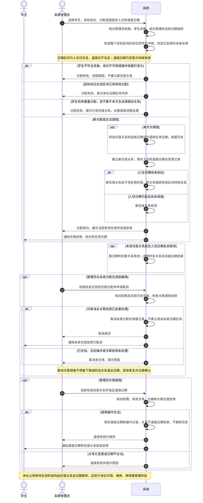

### 1.6 06 消息发布与接收时序图

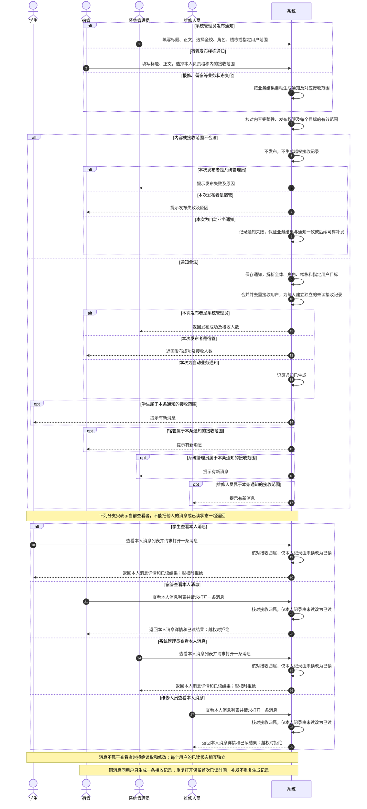

### 1.7 07 系统任务导入备份时序图

```mermaid
sequenceDiagram
    autonumber
    actor Admin as 系统管理员
    participant System as 系统

    Admin->>System: 选择数据导入、导出、创建备份或恢复及数据范围
    alt 导入或恢复需要输入文件
        Admin->>System: 上传导入文件或恢复文件
        System-->>Admin: 返回文件上传及初步校验结果
        opt 本次为恢复
            System-->>Admin: 展示备份来源、恢复范围和覆盖风险，要求二次确认
            Admin->>System: 二次确认本次恢复操作
        end
    else 导出或创建备份
        Admin->>System: 确定数据范围，无需上传输入文件
    end
    Admin->>System: 提交任务
    System->>System: 核对权限、输入、数据范围、恢复确认及任务互斥条件
    alt 校验不通过或未完成恢复确认
        System-->>Admin: 拒绝创建任务并说明原因
    else 校验通过
        System->>System: 创建待执行任务，保留任务类型、操作者和输入信息
        System-->>Admin: 返回任务编号，已受理不代表执行成功
        par 管理员跟踪或取消任务
            loop 管理员在任务结束前按需操作并查询最终结果
                Admin->>System: 查询任务进度、结果和错误明细
                System-->>Admin: 返回待执行、执行中、成功、部分成功、失败或已取消及相关结果
                opt 管理员申请取消尚未启动的任务
                    Admin->>System: 取消任务
                    System->>System: 再检查任务仍为待执行
                    alt 尚未开始执行
                        System->>System: 任务变为已取消，不再执行
                        System-->>Admin: 取消成功
                    else 已经执行或已终止
                        System-->>Admin: 不允许取消，返回当前状态
                    end
                end
            end
        and 系统后台执行任务
            System->>System: 再检查任务仍待执行且未取消
            alt 已取消或已被执行
                System->>System: 不重复执行该任务
            else 允许启动
                System->>System: 任务变为执行中
                alt 导入
                    System->>System: 检查文件结构，并逐行检查格式、重复和关联信息
                    alt 文件不可解析
                        System->>System: 任务变为失败，保存文件错误原因
                    else 文件可解析
                        loop 每一行导入数据
                            alt 内容和关联校验通过
                                System->>System: 保存合法行，记录成功数量
                            else 校验失败或该行业务处理失败
                                System->>System: 不保存非法行，记录行号、字段和错误原因
                            end
                        end
                        alt 全部行成功
                            System->>System: 任务变为成功
                        else 有成功行且有错误行
                            System->>System: 任务变为部分成功，保留完整错误明细
                        else 没有成功导入行
                            System->>System: 任务变为失败，保存原因和明细
                        end
                    end
                else 导出
                    System->>System: 按授权范围生成并校验导出文件
                    alt 导出成功
                        System->>System: 任务变为成功，提供导出文件
                    else 导出失败
                        System->>System: 任务变为失败，保存错误原因
                    end
                else 创建备份
                    System->>System: 创建备份文件并检查完整性
                    alt 备份生成及校验通过
                        System->>System: 任务变为成功，保存备份信息
                    else 备份生成或校验失败
                        System->>System: 任务变为失败，保存原因
                    end
                else 恢复
                    System->>System: 复核确认、文件完整性、兼容性和维护条件
                    alt 不符合恢复条件
                        System->>System: 任务变为失败，不执行数据覆盖
                    else 可以恢复
                        System->>System: 暂停相关业务写入，保留恢复前保护备份
                        System->>System: 执行恢复，检查恢复后的完整性
                        alt 恢复和完整性检查成功
                            System->>System: 任务变为成功，记录恢复结果，恢复相关业务
                        else 恢复失败
                            System->>System: 按保护备份回退，任务变为失败，保存恢复和回退结果
                            alt 回退及完整性检查成功
                                System->>System: 恢复相关业务
                            else 回退失败或仍无法确认一致性
                                System->>System: 保持维护状态，不恢复相关业务写入
                                System-->>Admin: 通知恢复失败且需人工处理
                            end
                        end
                    end
                end
                System->>System: 保存真实处理数量、结果文件、任务结果和操作记录
            end
        end
    end
    Note over Admin,System: 导入导出任务与备份恢复任务仍分别记录；只有导入可部分成功
    Note over Admin,System: 未预期执行异常按失败记录，保留已提交数量；重试新建关联任务，不改写原终态
    Note over Admin,System: 只支持启动前取消；恢复过程不能覆盖任务结果和审计历史；整批导入是否回滚仍需确认
```

### 1.8 12 维修延期审核时序图

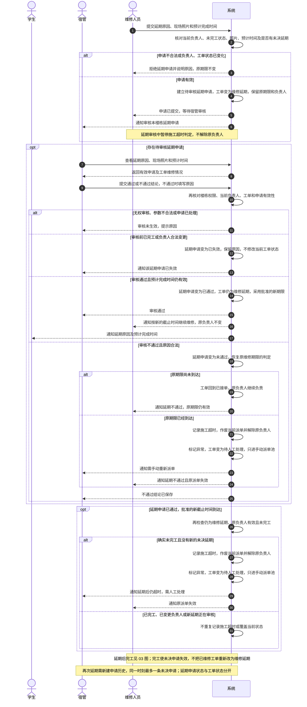

### 1.9 13 留宿变更补录时序图

```mermaid
sequenceDiagram
    autonumber
    actor Student as 学生
    actor Manager as 宿管
    actor Admin as 系统管理员
    participant System as 系统

    opt 管理员修改已发布的连续开放区间
        Admin->>System: 修改本次假期的开放开始和结束日期
        System->>System: 核对配置权限、连续区间及日期顺序
        alt 配置不合法或原配置已变化
            System-->>Admin: 拒绝修改并说明原因
        else 修改合法
            System->>System: 发布新区间，检查尚未归档的受影响申请
            System-->>Admin: 区间已更新，受影响申请须重新校验或复核
            System-->>Manager: 通知开放区间已变更及需复核申请
            System-->>Student: 通知新的开放区间和可能受影响的日期
            loop 每张受影响的已提交或已通过申请
                System->>System: 按最新区间重新检查该申请的所有日期段
                alt 原申请已通过
                    System->>System: 标记需复核，暂停完成归档，不符合新规则者暂不计入有效留宿人数
                    Manager->>System: 复核本楼栋申请并提交结论
                    System->>System: 再核对楼栋权限、当前申请和最新区间
                    alt 审核依据已变化或没有复核权限
                        System-->>Manager: 不接受过期或越权复核，保留待复核要求
                    else 日期符合新区间且复核通过
                        System->>System: 保存复核历史，仍为已通过并保持锁定
                        System-->>Manager: 复核通过
                        System-->>Student: 通知留宿批准继续有效
                    else 日期不符合或复核不通过，原因和重交期限合法
                        System->>System: 保存原因和重交期限，解锁并变为待修改
                        System-->>Manager: 复核结果已保存
                        System-->>Student: 通知按新区间修改并重新提交
                    else 退回原因或重交期限缺失
                        System-->>Manager: 复核未生效，须补充原因和期限
                    end
                else 待审核、审核中或待修改申请
                    System-->>Student: 提醒后续操作须符合新开放区间
                    System-->>Manager: 提醒后续审核使用最新区间和已提交版本
                end
            end
        end
    end

    opt 正常截止后出现特殊留宿需求
        alt 学生提出逾期补录需求
            Student->>System: 提出临时留宿需求
            System-->>Manager: 转达本楼栋学生的补录需求
            Manager->>System: 为指定学生设置例外受理权限、原因和截止时间
            System->>System: 核对楼栋权限，例外只适用于指定学生，不改全体截止时间
            alt 例外授权合法
                System-->>Student: 通知可在指定期限内补录
                Student->>System: 提交留宿日期段和事由
            else 无权授权或例外条件不合法
                System-->>Manager: 拒绝例外授权，不开放本次补录入口
            end
        else 宿管人工添加本楼栋学生
            Manager->>System: 为本楼栋学生录入日期段和留宿事由
        else 系统管理员人工添加学生
            Admin->>System: 为全校范围内指定学生录入日期段和留宿事由
        end
        opt 学生已获授权并提交，或管理人员已提交人工录入
            System->>System: 核对实际操作者、有效授权、学生资格、已有申请和最新日期规则
            alt 授权无效、已有不可编辑申请或日期与内容不合法
                System->>System: 不建立非法申请，不覆盖原提交内容
                alt 当前提交者是学生
                    System-->>Student: 提示补录未受理及原因
                else 当前提交者是宿管
                    System-->>Manager: 提示人工添加未受理及原因
                else 当前提交者是系统管理员
                    System-->>Admin: 提示人工添加未受理及原因
                end
            else 补录或人工添加合法
                System->>System: 沿用同学生同批次的唯一申请，保存新提交版本及真实录入人
                System->>System: 记录来源为逾期补录或人工添加，单独锁定，变为审核中
                System-->>Student: 通知特殊申请已受理并锁定
                System-->>Manager: 通知本楼栋特殊申请待审核
                alt 管辖宿管执行审核
                    Manager->>System: 查看锁定版本并提交审核结论
                else 系统管理员获明确的特殊申请审核或复核授权
                    Admin->>System: 查看锁定版本并提交审核或复核结论
                end
                System->>System: 核对审核权限、申请来源、锁定内容和最新开放区间
                alt 越权、依据已变化或审核参数不合法
                    System->>System: 不应用非法审核结果，保留当前状态
                else 审核通过
                    System->>System: 保存审核历史，变为已通过并保持锁定，纳入留宿人数
                    System-->>Student: 通知特殊留宿申请已通过
                else 审核不通过且原因和重交期限合法
                    System->>System: 保存原因和重交期限，解锁，变为待修改
                    System-->>Student: 通知修改原因和重新提交期限
                end
                alt 本次审核者是宿管
                    System-->>Manager: 返回审核结果或未生效原因
                else 本次审核者是系统管理员
                    System-->>Admin: 返回审核复核结果或未生效原因
                end
            end
        end
    end
    Note over Manager,System: 系统管理员不自动代替宿管常规楼栋审核；是否双人双审仍待确认
    Note over Student,System: 正常、补录、人工添加是申请来源而非状态；重交和归档见 04 图，不增加第二张同批次申请
    Note over Student,System: 留宿人数指获准留宿人数，不表示实际入住，不新增提前离宿或延长留宿流程
```

### 1.10 17 维修确认评价重修时序图

```mermaid
sequenceDiagram
    autonumber
    actor Student as 学生
    actor Manager as 宿管
    actor Worker as 维修人员
    participant System as 系统

    Note over Student,System: 原工单为已维修，维修结果和完工照片已提交，学生是工单申请人
    opt 学生在确认前操作
        Student->>System: 查看本人工单的维修结果和完工照片
        System-->>Student: 返回结果及当前可用操作
        alt 学生确认维修完成
            Student->>System: 确认维修完成
            System->>System: 再核对申请人身份及原工单仍为已维修
            alt 可以确认
                System->>System: 保存学生确认事实，原工单变为已确认
                System-->>Student: 确认成功，可提交评价
            else 已确认、已归档或无权操作
                System-->>Student: 返回已处理结果或拒绝，不重复确认
            end
        else 学生认为问题未解决，申请重修
            Student->>System: 提交重修说明和必要补充图片
            System->>System: 核对申请人、原工单仍未确认、重修次数和补充内容
            alt 原工单已确认或已归档、无权操作或内容不合法
                System-->>Student: 不接受重修并说明原因
            else 已达到重修上限
                System-->>Student: 不生成重修工单，仍有故障时新建普通报修
            else 未达上限且申请合法
                System->>System: 保留原工单为已维修，另建关联重修工单，初始为待审核
                System-->>Student: 返回新重修工单和原工单联系
                System-->>Manager: 通知审核关联重修工单
                Note over Manager,System: 宿管按 02 图核对楼栋权限、当前提交版本和审核状态
                opt 重修工单仍待审核，宿管进行审核
                    Manager->>System: 查看重修内容并提交审核结论
                    System->>System: 再核对审核权限、工单状态及当前提交内容
                    alt 权限或状态失效、审核原因不合法
                        System-->>Manager: 审核未生效并说明原因
                    else 审核通过
                        System->>System: 新重修工单变为待派单，只进入手动派单池
                        System-->>Manager: 重修审核通过，需强制派单
                        System-->>Student: 通知重修已通过，等待维修安排
                        Note over Manager,Worker: 按 03 图手动派单，系统自动确认接单，维修人员负责新重修工单
                        opt 新重修工单已接单且当前负责人完成维修
                            Worker->>System: 提交新重修工单的维修结果和完工照片
                            System->>System: 按 03 图核对当前负责人、状态和完工内容
                            alt 完工提交有效
                                System->>System: 新重修工单变为已维修，开始该工单确认计时
                                System-->>Worker: 完工提交成功，等待学生确认
                                System-->>Student: 通知确认新重修工单结果，确认与评价仍使用本图流程
                            else 当前派单或完工内容不合法
                                System-->>Worker: 不接受完工提交并提示原因
                            end
                        end
                    else 审核不通过
                        System->>System: 新重修工单变为待修改，记录原因和重交期限
                        System-->>Manager: 重修审核退回结果已保存
                        System-->>Student: 通知重修需修改，重交和逾期关闭按 02 图
                    end
                end
            end
        end
    end

    opt 某张已维修工单到达自动确认期限
        System->>System: 再检查该工单仍为已维修且满足自动确认规则
        alt 仍可自动确认
            System->>System: 保存系统自动确认事实，该工单变为已确认
            System-->>Student: 通知该工单已自动确认，不能再基于该工单申请重修
        else 已确认、已归档或尚未到期
            System->>System: 不重复执行自动确认
        end
    end

    opt 某张工单已确认，进入评价或归档处理
        alt 学生提交评价
            Student->>System: 提交本人已确认工单的评分和评价
            System->>System: 核对本人、已确认状态、评分范围和是否已评价
            alt 首次合法评价
                System->>System: 保存评价，该工单变为已归档
                System-->>Student: 评价成功，工单已归档
            else 已评价、已归档或评价不合法
                System-->>Student: 返回已处理结果或拒绝，不新增重复评价
            end
        else 按已确认的业务归档规则完成归档
            System->>System: 再检查已确认状态和归档条件
            System->>System: 保存归档时间和确认历史，不伪造学生评分或评价
        end
    end
    Note over Student,System: 重修工单独立审核、派单、确认和归档，不把原工单改回已接单
    Note over Student,System: 重修是否暂停原单自动确认、未评价工单何时归档仍待业务确认，不推定暂停或补评价
```

## 2. 状态图

### 2.1 08 报修工单状态图

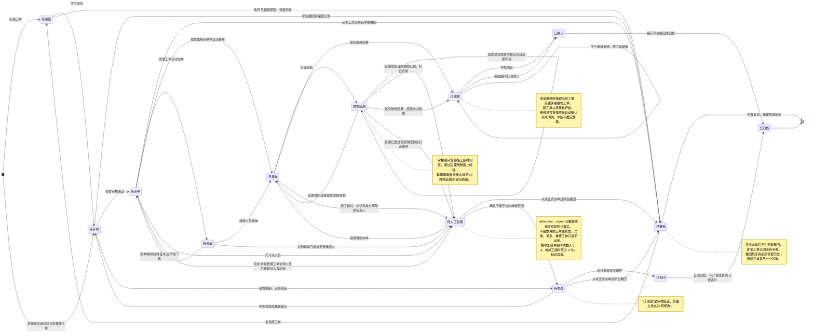

### 2.2 09 派单记录状态图

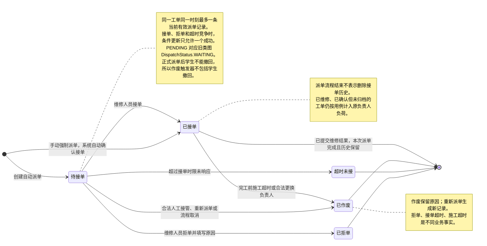

### 2.3 10 留宿申请状态图

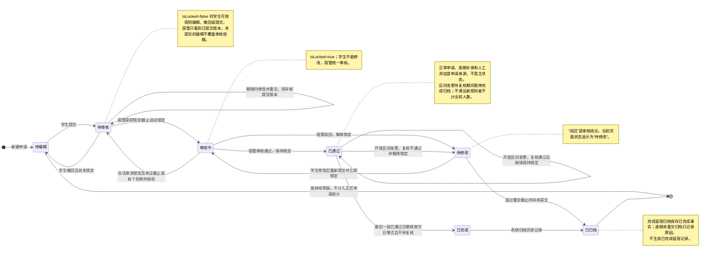

### 2.4 11 住宿分配状态图

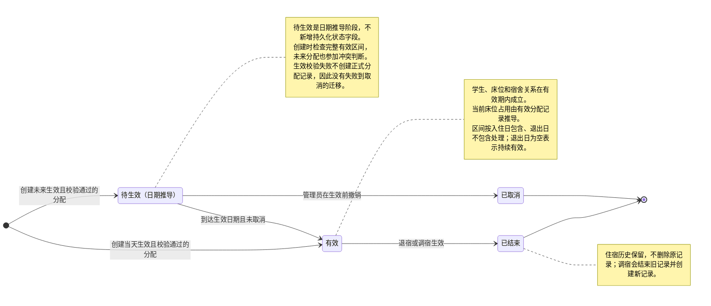

### 2.5 14 维修延期申请状态图

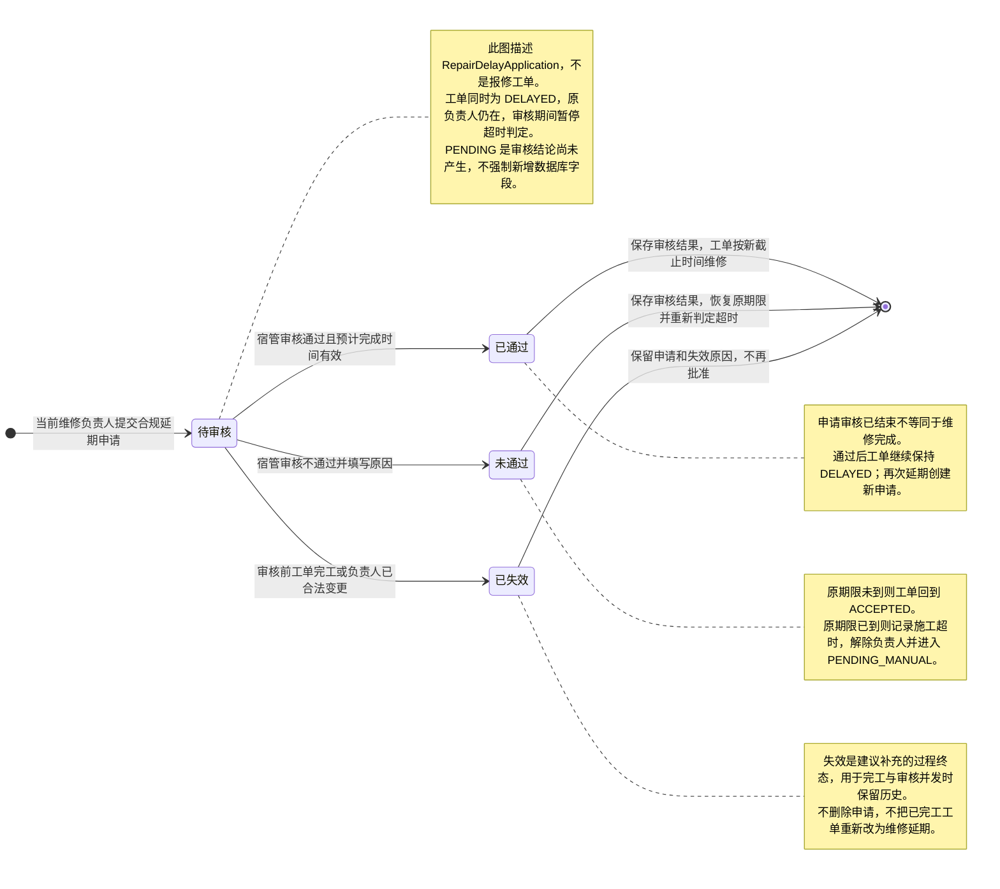

### 2.6 15 系统任务状态图

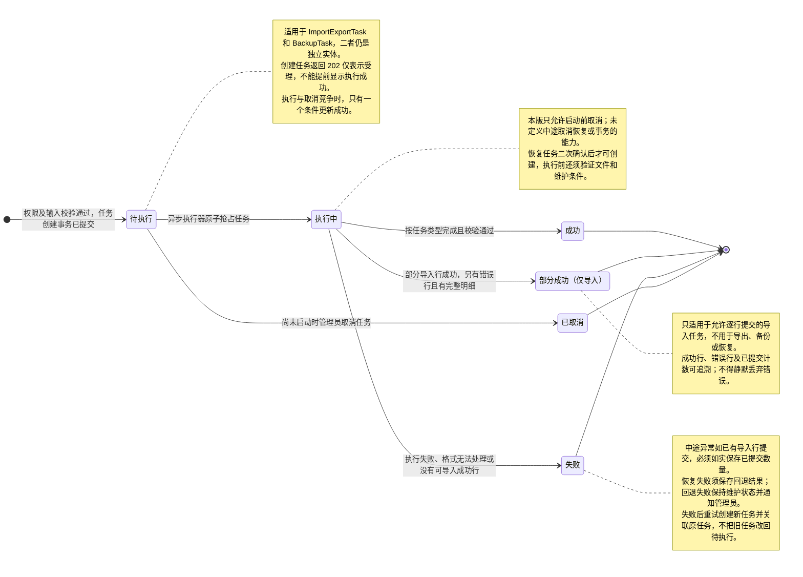

### 2.7 16 消息接收记录状态图

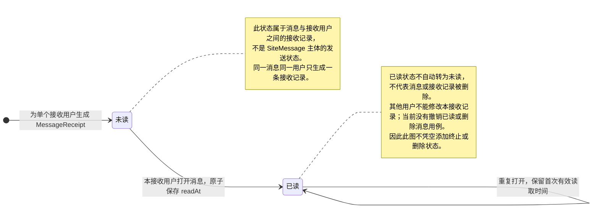
